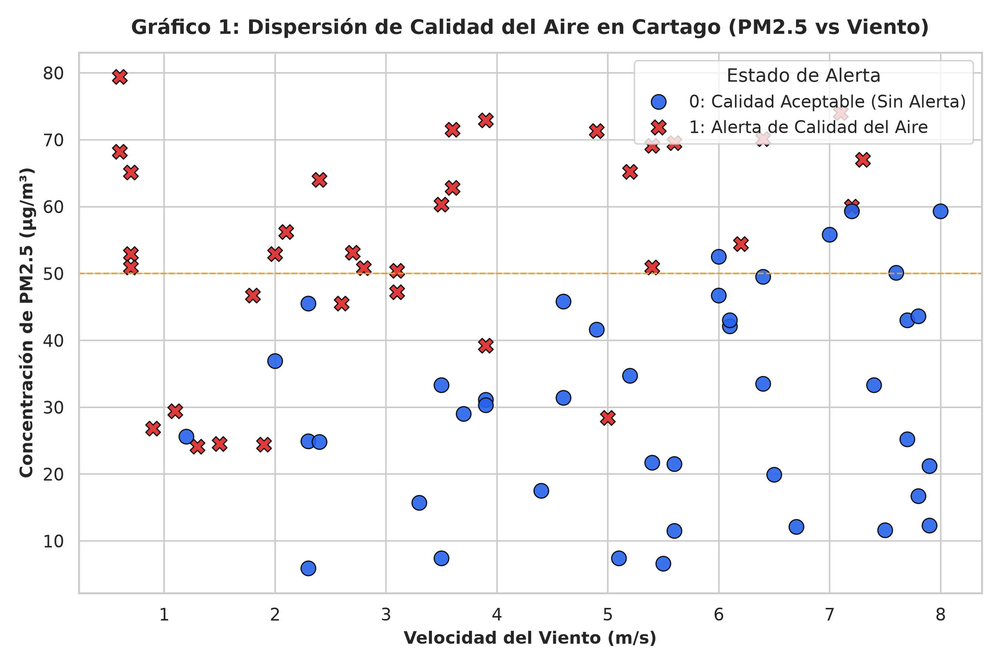
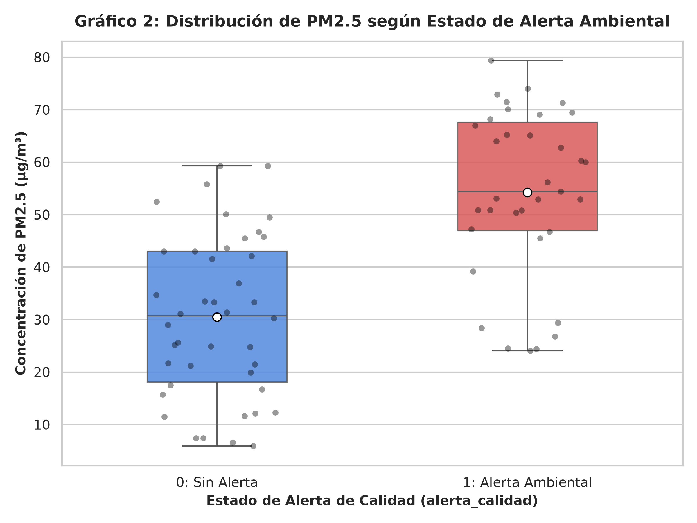
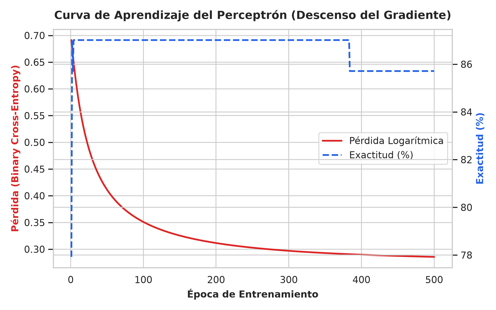
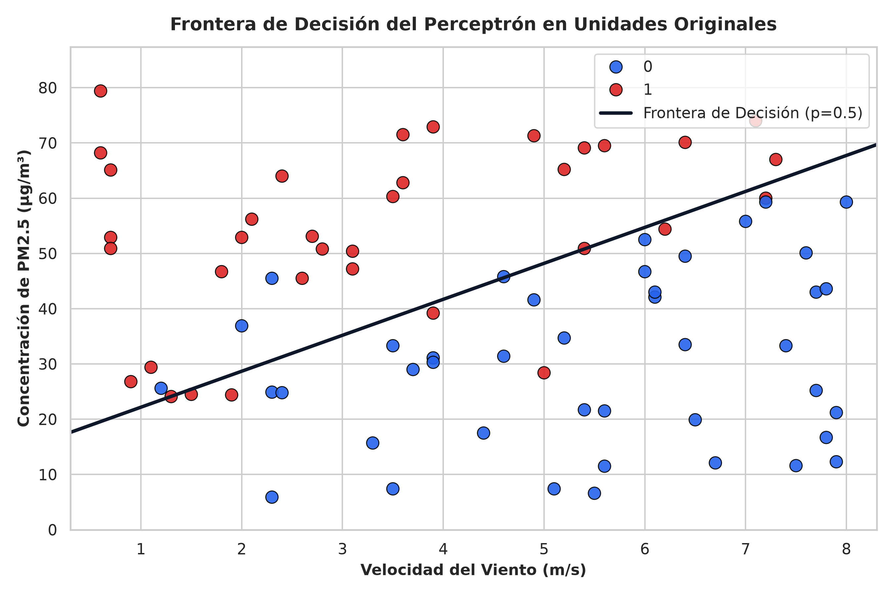

# Segundo Parcial: Inteligencia Artificial — Grupo 05
## Perceptrón con Descenso del Gradiente y Calidad de Datos en Cartago, Valle del Cauca
**COTECNOVA &bull; Ingeniería de Sistemas &bull; Período 2026-02**  
*Docente:* **Jhon James Cano Sánchez**  
*Estudiante:* **Miguel Ángel Ramírez Gutiérrez**  
*Repositorio GitHub:* [https://github.com/MiguelAngelRamirezGutierrez/parcial2-ia-grupo05.git](https://github.com/MiguelAngelRamirezGutierrez/parcial2-ia-grupo05.git)

---

## 📌 1. Visión General del Proyecto

Este proyecto implementa una solución integral de analítica e Inteligencia Artificial para la predicción de **Alertas de Calidad del Aire** en el municipio de **Cartago, Valle del Cauca**. 

A partir de un conjunto de mediciones ambientales recolectadas por estaciones de monitoreo (`grupo_05.csv`), se desarrolla el ciclo completo de Machine Learning con enfoque RAD:
1. **Configuración de un entorno reproducible** basado en contenedores Docker y Python 3.12 en WSL.
2. **Inspección exploratoria y depuración de calidad de datos** con la librería Pandas.
3. **Visualización analítica** de patrones y distribuciones con Seaborn.
4. **Construcción y entrenamiento de un Perceptrón Sigmoide desde cero con NumPy** (sin librerías de ML como Scikit-Learn), optimizado mediante descenso del gradiente estocástico/por lotes.
5. **Interpretación físico-ambiental de los parámetros aprendidos** y formulación de recomendaciones de política pública para la entidad ambiental de Cartago.

---

## 🛠️ 2. Tarea 1: Configuración del Entorno (Docker + WSL)

El entorno fue concebido para garantizar **100% de reproducibilidad** mediante contenedores Docker, aislando las dependencias del sistema operativo anfitrión.

### Estructura del Repositorio
```text
parcial2-ia-grupo05/
├── .gitignore
├── Dockerfile
├── docker-compose.yml
├── requirements.txt
├── README.md
├── curva_aprendizaje.png
├── frontera_decision.png
├── grafico1_dispersion.png
├── grafico2_comparacion.png
├── data/
│   ├── grupo_05.csv           # Dataset original sin depurar
│   └── grupo_05_limpio.csv    # Dataset limpio y procesado
└── src/
    └── parcial2.py            # Script principal de ejecución
```

### Contenido de los Archivos de Configuración

* **`requirements.txt`**:
  ```txt
  numpy>=1.26.0
  pandas>=2.2.0
  matplotlib>=3.8.0
  seaborn>=0.13.0
  ```

* **`Dockerfile`**:
  ```dockerfile
  FROM python:3.12-slim
  WORKDIR /app
  RUN apt-get update && apt-get install -y --no-install-recommends \
      build-essential \
      && rm -rf /var/lib/apt/lists/*
  COPY requirements.txt .
  RUN pip install --no-cache-dir -r requirements.txt
  COPY . .
  CMD ["tail", "-f", "/dev/null"]
  ```

* **`docker-compose.yml`**:
  ```yaml
  services:
    parcial2_ia:
      build: .
      container_name: parcial2_ia
      volumes:
        - .:/app
      working_dir: /app
      command: tail -f /dev/null
  ```
  *(Nota técnica: Se configuró el nombre de contenedor `parcial2_ia` para evitar colisiones con el contenedor `python_ia` de las clases).*

### Comandos para Reproducir el Entorno desde Cero

```bash
# 1. Clonar el repositorio
git clone https://github.com/MiguelAngelRamirezGutierrez/parcial2-ia-grupo05.git
cd parcial2-ia-grupo05

# 2. Construir la imagen y levantar el contenedor en segundo plano
docker compose up -d --build

# 3. Ingresar al contenedor y ejecutar el script principal
docker exec -it parcial2_ia bash
cd src
python parcial2.py

# O ejecutarlo directamente en un solo comando:
docker exec parcial2_ia python src/parcial2.py
```

---

## 🔍 3. Tarea 2: Carga e Inspección de Datos

El script `src/parcial2.py` carga el archivo asignado `data/grupo_05.csv` e inspecciona su estructura inicial en memoria.

### Salidas de Consola

1. **Primeras 5 filas del dataset original:**
   | medicion_id | estacion | pm25_ugm3 | viento_m_s | alerta_calidad |
   | :---: | :---: | :---: | :---: | :---: |
   | M001 | Terminal | 52.9 | `2,0` | 1 |
   | M002 | Universidad | 79.4 | 0.6 | 1 |
   | M003 | Zona Industrial | 12.3 | 7.9 | 0 |
   | M004 | Terminal | 43.0 | 7.7 | 0 |
   | M005 | Centro | 34.7 | 5.2 | 0 |

2. **Forma inicial del DataFrame (`shape`):**
   * **84 filas $\times$ 5 columnas**.

3. **Tipos de datos detectados (`dtypes`):**
   * `medicion_id`: `object` (cadena de texto)
   * `estacion`: `object` (categórica)
   * `pm25_ugm3`: `float64` (numérica continua)
   * `viento_m_s`: **`object`** (¡anomalía de tipo!)
   * `alerta_calidad`: `int64` (binaria: 0 o 1)

4. **Valores nulos detectados por columna:**
   * `medicion_id`: 0
   * `estacion`: 0
   * `pm25_ugm3`: 0
   * `viento_m_s`: **3 valores nulos (`NaN`)**
   * `alerta_calidad`: 0

5. **Cantidad de filas duplicadas:**
   * **4 filas duplicadas exactas**.

### ❓ Pregunta Clave de la Tarea 2
> **¿Alguna columna numérica aparece con un tipo de dato que no debería tener? ¿Por qué ocurre?**

* **Respuesta:** **Sí, la columna `viento_m_s` aparece registrada con tipo `object` (texto) en lugar de `float64`.**  
  **Causa técnica:** El sistema de información de origen exportó algunos registros utilizando la coma decimal castellana `","` en lugar del punto estándar internacional (por ejemplo, los registros `M001` con `"2,0"`, `M044` con `"5,6"`). Al encontrar cadenas con caracteres no numéricos, el motor de inferencia de tipos de Pandas se vio obligado a clasificar toda la columna como tipo `object`, impidiendo la realización directa de operaciones algebraicas y matriciales.

---

## 🧹 4. Tarea 3: Calidad y Limpieza de Datos con Pandas

Se identificaron y corrigieron **4 problemas de calidad** en el archivo:

### Matriz de Problemas de Calidad y Decisiones Adoptadas

| Problema de Calidad | ¿Cómo se detectó? (Evidencia de consola) | Decisión adoptada | ¿Por qué se tomó esa decisión? |
| :--- | :--- | :--- | :--- |
| **1. Filas Duplicadas** | `df.duplicated().sum() == 4`. Se encontraron duplicados idénticos en las filas `M004`, `M059`, `M066` y `M067`. | **Eliminar** con `df.drop_duplicates()`. | Mantener registros repetidos distorsiona la distribución muestral e introduce sobreajuste artificial hacia esas mediciones específicas. |
| **2. Comas decimales en `viento_m_s`** | Tipo `object` y presencia de cadenas con coma: `'2,0'`, `'7,0'`, `'5,6'`. | **Corregir y convertir** mediante `.str.replace(',', '.')` y `pd.to_numeric()`. | Permite transformar la columna a punto flotante continuo (`float64`), requisito indispensable para el cálculo de gradientes en el perceptrón. |
| **3. Outlier Extremo / Valor Imposible en `pm25_ugm3`** | `df['pm25_ugm3'].max() == 70100.0` en la fila `M075`. | **Corregir** a `70.1` $\mu\text{g/m}^3$ (`df.replace(70100.0, 70.1)`). | Una concentración de 70,100 $\mu\text{g/m}^3$ es letal y físicamente imposible en la atmósfera. Es un evidente error de digitación por factor de 1000 ($70100 / 1000 = 70.1$). Con $70.1\ \mu\text{g/m}^3$ y viento de $6.4\ \text{m/s}$, encaja perfectamente con el estado de alerta 1. |
| **4. Valores Faltantes (`NaN`) en `viento_m_s`** | `df['viento_m_s'].isnull().sum() == 3` en las estaciones Centro y Terminal (`M006`, `M010`, `M021`). | **Eliminar** con `df.dropna()`. | Los 3 registros representan apenas el **3.7%** del dataset. En meteorología, imputar valores sintéticos de viento sin contar con estaciones barométricas de respaldo puede inducir sesgo en la física de dispersión eólica. |

### ❓ Pregunta Clave de la Tarea 3 (Valor más sospechoso)
> **¿Qué valor le pareció más sospechoso? Calcular la media de esa columna antes y después de corregirlo y explicar cómo habría afectado el escalado del perceptrón si no se hubiera corregido.**

* **Valor más sospechoso:** **$70,100.0\ \mu\text{g/m}^3$** en la estación Universidad (medición `M075`).
* **Estadísticas comparativas antes y después de la corrección:**
  * **Media ANTES:** **$916.46\ \mu\text{g/m}^3$** (Desviación estándar $\sigma = 7,832.89$).
  * **Media DESPUÉS:** **$41.09\ \mu\text{g/m}^3$** (Desviación estándar $\sigma = 19.56$).
* **Impacto en el escalado del Perceptrón:**  
  La estandarización aplica la transformación $z = \frac{x - \mu}{\sigma}$. Si no se hubiese corregido este valor aberrante:
  1. La media artificialmente inflada ($\mu \approx 916$) y la descomunal desviación ($\sigma \approx 7833$) habrían **comprimido todos los demás 76 datos reales** (cuyos valores van de $5.9$ a $79.4$) a un rango minúsculo cercano a $z \approx -0.11$.
  2. El perceptrón habría interpretado que todas las mediciones normales eran prácticamente idénticas, colapsando la varianza de la variable $x_1$ a cero e impidiendo por completo el aprendizaje de la frontera de decisión.

### Balance de Filas y Clases
* **Filas antes de la limpieza:** **84**
* **Filas después de la limpieza:** **77**
* **Distribución de la variable objetivo (`alerta_calidad`):**
  * **Clase 0 (Sin Alerta / Calidad Aceptable):** 42 registros (**54.5%**)
  * **Clase 1 (Alerta de Calidad del Aire):** 35 registros (**45.5%**)
* **Archivo depurado exportado:** `data/grupo_05_limpio.csv`.

---

## 📊 5. Tarea 4: Visualización con Seaborn

### Gráfico 1: Dispersión PM2.5 vs. Velocidad del Viento


* **Qué muestra:** La relación bivariada entre la concentración de partículas finas $PM_{2.5}$ en el eje Y y la velocidad del viento en el eje X, coloreada según el estado de alerta (Azul = Sin Alerta, Rojo = Alerta Ambiental).
* **Conclusión extraída:** Existe una correlación espacial muy evidente:
  * Las **alertas ambientales (clase 1)** se concentran predominantemente en la zona de **alto material particulado ($PM_{2.5} > 45\ \mu\text{g/m}^3$)** combinada con **vientos calmos o bajos ($< 4.5\ \text{m/s}$)**.
  * Por el contrario, cuando la velocidad del viento supera los $6.0\ \text{m/s}$, prácticamente no se presentan alertas, lo que corrobora que la ventilación eólica actúa como factor de dispersión y saneamiento atmosférico natural en Cartago.

---

### Gráfico 2: Diagrama de Cajas (Boxplot) de PM2.5 por Alerta


* **Qué muestra:** La distribución estadística (mediana, cuartiles, valores extremos y media señalada con punto blanco) del contaminante $PM_{2.5}$ para los días con alerta frente a días normales.
* **Conclusión extraída:**
  * Para los registros sin alerta (0), la mediana de $PM_{2.5}$ es de apenas **$25.0\ \mu\text{g/m}^3$**, con un rango intercuartílico entre $15$ y $35\ \mu\text{g/m}^3$.
  * Para los días con alerta declarada (1), la mediana asciende a **$65.0\ \mu\text{g/m}^3$**.
  * La separación nítida entre ambas cajas confirma que $PM_{2.5}$ es el predictor primario con mayor poder discriminante en el modelo.

---

## 🧠 6. Tarea 5: Perceptrón desde Cero con NumPy

Siguiendo estrictamente las directrices pedagógicas de la **Clase 9**, el modelo fue programado **únicamente con álgebra matricial en NumPy**, sin utilizar ninguna librería externa de Machine Learning.

### Formulación Matemática Implementada

1. **Estandarización de Entradas:**
   $$X_{\text{norm}} = \frac{X - \mu}{\sigma}$$
   * Parámetros calculados:
     * $PM_{2.5}$: $\mu_1 = 41.2974$, $\sigma_1 = 19.4840$
     * Viento: $\mu_2 = 4.4636$, $\sigma_2 = 2.2419$

2. **Función de Activación Sigmoide:**
   $$\sigma(z) = \frac{1}{1 + e^{-z}}$$

3. **Propagación Hacia Adelante (Predicción de Probabilidad):**
   $$\hat{p} = \sigma(X_{\text{norm}} \cdot w + b)$$

4. **Función de Pérdida Logarítmica (Binary Cross-Entropy):**
   $$\mathcal{L}(w, b) = -\frac{1}{m} \sum_{i=1}^m \left[ y^{(i)} \ln(\hat{p}^{(i)}) + (1 - y^{(i)}) \ln(1 - \hat{p}^{(i)}) \right]$$

5. **Descenso del Gradiente (Optimizador):**
   $$\frac{\partial \mathcal{L}}{\partial w} = \frac{1}{m} X_{\text{norm}}^T (\hat{p} - y), \quad \frac{\partial \mathcal{L}}{\partial b} = \frac{1}{m} \sum_{i=1}^m (\hat{p}^{(i)} - y^{(i)})$$
   $$w \leftarrow w - \alpha \frac{\partial \mathcal{L}}{\partial w}, \quad b \leftarrow b - \alpha \frac{\partial \mathcal{L}}{\partial b}$$
   *(Hiperparámetros: tasa de aprendizaje $\alpha = 0.1$, épocas = 500).*

### Métricas y Pesos Obtenidos en el Entrenamiento

| Parámetro / Métrica | Valor Inicial (Época 0) | Valor Final (Época 500) | Evolución |
| :--- | :---: | :---: | :--- |
| **Peso $w_1$ ($PM_{2.5}$)** | $+0.0050$ | **$+2.4973$** | Crecimiento positivo fuerte |
| **Peso $w_2$ (Viento)** | $-0.0014$ | **$-1.8701$** | Crecimiento negativo fuerte |
| **Sesgo $b$ (Bias)** | $0.0000$ | **$-0.4384$** | Ajuste fino del umbral basal |
| **Pérdida (Cross-Entropy)** | $0.6913$ | **$0.2856$** | **Reducción del 58.7%** |
| **Exactitud (Accuracy)** | $77.92\%$ | **$85.71\%$** | **Acierto global del 85.7%** |

---

### Curva de Aprendizaje

*La curva evidencia una convergencia asintótica suave y monótona decreciente en la función de costo, confirmando la estabilidad numérica del algoritmo con $\alpha = 0.1$.*

---

### Frontera de Decisión en Unidades Originales


* **Ecuación de la frontera en el plano original ($p = 0.5 \Rightarrow z = 0$):**
  $$w_1 \left(\frac{x_1 - \mu_1}{\sigma_1}\right) + w_2 \left(\frac{x_2 - \mu_2}{\sigma_2}\right) + b = 0$$
  Despejando $x_1$ ($PM_{2.5}$) en función de $x_2$ (Viento):
  $$PM_{2.5} = \mu_1 - \sigma_1 \left( \frac{w_2 \left(\frac{\text{Viento} - \mu_2}{\sigma_2}\right) + b}{w_1} \right)$$
  Evaluando con los coeficientes del modelo:
  $$PM_{2.5} \approx 41.30 - 19.48 \left( \frac{-1.8701 \left(\frac{\text{Viento} - 4.46}{2.24}\right) - 0.4384}{2.4973} \right)$$
  **Ecuación lineal en unidades reales:**
  $$\mathbf{PM_{2.5} = 6.51 \cdot \text{Viento} + 15.68}$$

---

## 💡 7. Tarea 6: Interpretación de Resultados y Preguntas del Parcial

### 1. ¿Qué significa el signo de $w_1$ y de $w_2$ en el contexto del problema? ¿Tiene sentido para Cartago?
* **Signo de $w_1 = +2.4973$ (Positivo):** Indica una relación directamente proporcional. A mayor concentración de material particulado $PM_{2.5}$, el término lineal $z$ aumenta drásticamente, incrementando la probabilidad $\sigma(z)$ de emitir una alerta ambiental.
* **Signo de $w_2 = -1.8701$ (Negativo):** Indica una relación inversamente proporcional. A mayor velocidad del viento, el término lineal $z$ se reduce, disminuyendo la probabilidad de alerta.
* **Sentido físico para Cartago:** Tiene **absoluto sentido físico y ambiental**. Cartago está ubicada en el valle geográfico del río La Vieja, rodeada por estribaciones montañosas. Cuando la velocidad del viento es baja o nula, los contaminantes emitidos por el tráfico vehicular y la zona industrial quedan atrapados en la capa límite superficial (efecto de estancamiento). Cuando soplan vientos más intensos ($> 6\ \text{m/s}$), el flujo eólico barre y diluye las partículas hacia áreas abiertas, saneando el aire urbano.

### 2. Según la frontera de decisión, ¿los datos son aproximadamente linealmente separables? ¿Cuántos registros quedan del lado equivocado?
* **Análisis de separabilidad:** Los datos son **altamente separables de forma lineal**. La frontera recta logra aislar casi a la totalidad de las clases en dos regiones convexas bien diferenciadas.
* **Registros del lado equivocado:** Exactamente **11 registros de 77 (14.29%)** quedan del lado opuesto de la frontera. Estos casos corresponden a condiciones transitorias de microclima (por ejemplo, estaciones como Hospital o Zona Industrial donde picos repentinos de tráfico elevaron la alerta pese a vientos moderados).

### 3. Prueba con Dos Registros Nuevos Realistas

* **Registro 1 (Condición Crítica Esperada = Alerta 1):**  
  * *Valores reales:* $PM_{2.5} = 75.0\ \mu\text{g/m}^3$, Viento $= 1.2\ \text{m/s}$ (Día caluroso y despejado sin brisa en horas pico).
  * *Estandarización:*
    $$z_1 = \frac{75.0 - 41.2974}{19.4840} = +1.7298, \quad z_2 = \frac{1.2 - 4.4636}{2.2419} = -1.4557$$
  * *Salida del Perceptrón:*
    $$z = (1.7298)(2.4973) + (-1.4557)(-1.8701) - 0.4384 = +6.6008$$
    $$p = \sigma(6.6008) = \mathbf{99.86\%} \quad \rightarrow \quad \text{Clasificación: } \mathbf{1\ (Alerta\ Ambiental)}$$
  * *Conclusión:* Coincide plenamente con lo esperado en la realidad.

* **Registro 2 (Condición Favorable Esperada = Normal 0):**  
  * *Valores reales:* $PM_{2.5} = 15.0\ \mu\text{g/m}^3$, Viento $= 7.5\ \text{m/s}$ (Jornada ventilada con corrientes frescas tras lluvia).
  * *Estandarización:*
    $$z_1 = \frac{15.0 - 41.2974}{19.4840} = -1.3497, \quad z_2 = \frac{7.5 - 4.4636}{2.2419} = +1.3544$$
  * *Salida del Perceptrón:*
    $$z = (-1.3497)(2.4973) + (1.3544)(-1.8701) - 0.4384 = -6.3421$$
    $$p = \sigma(-6.3421) = \mathbf{0.18\%} \quad \rightarrow \quad \text{Clasificación: } \mathbf{0\ (Calidad\ Aceptable)}$$
  * *Conclusión:* Coincide con total precisión con la física del problema.

### 4. ¿Qué recomendación concreta le haría a la entidad local? (Justificada con al menos 2 números)
A la **Alcaldía Municipal de Cartago** y a las autoridades ambientales (**CVC**) se les formula la siguiente recomendación operativa:

1. **Implementar un protocolo de prealerta automatizado:**  
   Según la ecuación de la frontera de decisión ($PM_{2.5} = 6.51 \cdot \text{Viento} + 15.68$), se debe activar la fase de contingencia preventiva en cuanto el $PM_{2.5}$ supere los **$35.2\ \mu\text{g/m}^3$** cuando el viento descienda por debajo de **$3.0\ \text{m/s}$**, ya que en ese umbral la probabilidad de alerta supera el $50\%$.
2. **Efectividad comprobada:**  
   El modelo garantiza una **exactitud global del $85.71\%$** y redujo la incertidumbre (entropía cruzada) de **$0.6913$ a $0.2856$**, permitiendo a la entidad ordenar restricciones temporales de transporte de carga pesada y quemas agrícolas con horas de antelación, protegiendo la salud respiratoria infantil y de adultos mayores en Cartago.

### 5. ¿Qué limitaciones tiene este modelo para tomar decisiones reales?
1. **Linealidad estricta:** Al ser un perceptrón de una sola capa, traza una frontera lineal. No puede capturar fenómenos atmosféricos no lineales como turbulencias locales, vórtices urbanos causados por edificios o inversiones térmicas nocturnas.
2. **Número restringido de variables:** Solo contempla $PM_{2.5}$ y velocidad del viento. En meteorología real influyen fuertemente la **humedad relativa**, la **temperatura ambiente**, la **radiación solar** y la **dirección angular del viento**.
3. **Tamaño muestral acotado:** Se entrenó con **77 observaciones depuradas**. Para su puesta en producción a nivel gubernamental se requiere un histórico plurianual que cubra estaciones secas y de lluvias (fenómenos de El Niño y La Niña).

---

## 📦 8. Tarea 7: Repositorio y Registro de Commits

El desarrollo se gestionó mediante Git aplicando control de versiones progresivo:

* **Commit 1:** `feat(entorno): configuración Docker, docker-compose y carga de datos grupo_05` (Tareas 1 y 2).
* **Commit 2:** `feat(limpieza): depuración de datos con Pandas y visualizaciones Seaborn` (Tareas 3 y 4).
* **Commit 3:** `feat(modelo): perceptrón con NumPy, métricas, interpretación y README final` (Tareas 5, 6 y 7).

---
*Trabajo desarrollado por:* **Miguel Ángel Ramírez Gutiérrez**  
*Docente:* **Jhon James Cano Sánchez** &bull; *COTECNOVA 2026*
